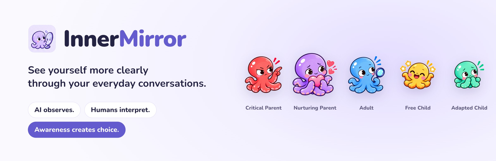
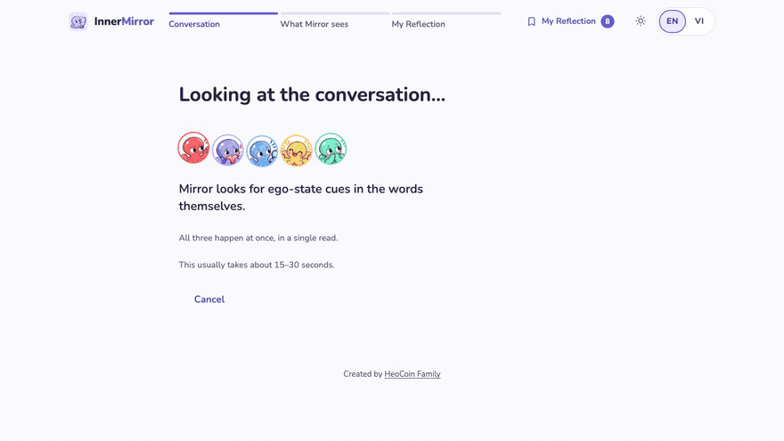
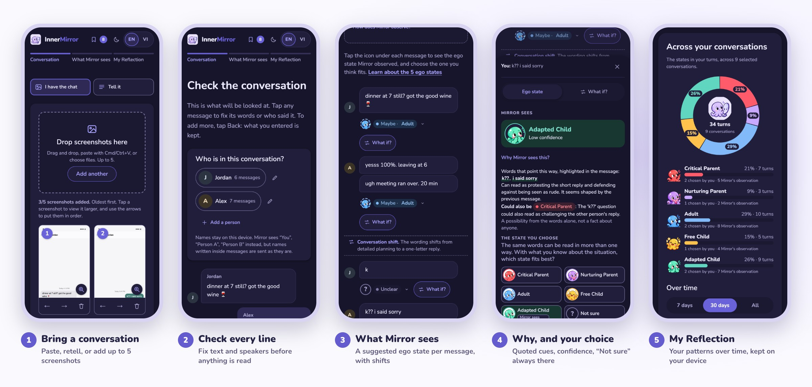
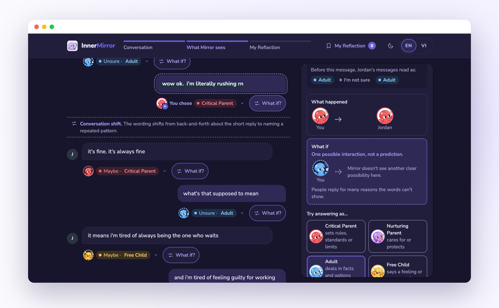
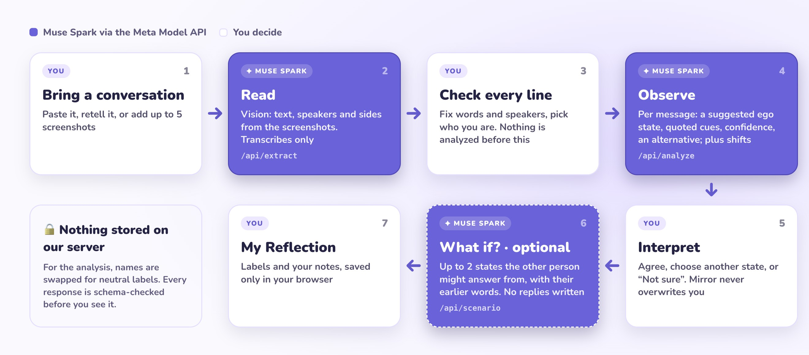

<a href="https://innermirror-flame.vercel.app">
  <picture>
    <source media="(prefers-color-scheme: dark)" srcset="design/readme/img/hero-dark.jpg">
    
  </picture>
</a>

<p align="center">
  <a href="https://innermirror-flame.vercel.app"></a>
</p>
<p align="center">
  
  
  
  
</p>
<p align="center">
  <a href="#the-conversation-you-keep-replaying">Story</a> ·
  <a href="#see-it-in-action">See it in action</a> ·
  <a href="#how-muse-spark-powers-innermirror">Muse Spark</a> ·
  <a href="#privacy-and-safety-by-design">Privacy</a> ·
  <a href="#run-it-locally">Run locally</a>
</p>

---

## The conversation you keep replaying

It's late. You're still going over a chat that went wrong: the short "k", the reply you sent too fast, the fight you've somehow had before. And the question in your head is usually about *them*: **why do they always…?**

InnerMirror gently turns that question around: **which part of me was speaking?**

Transactional Analysis describes a few recognizable "voices" we all speak from. When you can see which one took over in a moment, you get something valuable for next time: **a choice**.

> **🔍 AI observes.** Mirror, the app's AI observer, suggests an ego state for each message and quotes the exact words behind it. When the words are unclear, it says so.
>
> **🧭 Humans interpret.** You decide what fits, or answer **“I'm not sure”**. Mirror's view and yours stay side by side, and the AI never overwrites you.
>
> **🌱 Awareness creates choice.** Explore how a different reply might land, and notice your own patterns over time, privately, on your device.

### Meet the five voices

Everyone speaks from all five. A state belongs to a **message**, never to a person.

| | Ego state | What this voice does |
|:-:|---|---|
|  | **Critical Parent** | sets rules, standards and limits |
|  | **Nurturing Parent** | cares for and protects |
|  | **Adult** | weighs facts and options |
|  | **Free Child** | expresses feelings and wants |
|  | **Adapted Child** | adjusts to others' expectations |

## See it in action

<p align="center">
  
</p>
<p align="center"><sub>Recorded from a live run: the real app in Dark Mode with Muse Spark on a synthetic conversation (1.5× speed). The same take is the product demo in our video.</sub></p>

### The journey

<picture>
  <source media="(prefers-color-scheme: dark)" srcset="design/readme/img/phones-dark.jpg">
  
</picture>

1. **Bring a conversation.** Paste it, retell it as a story (type or speak), or add up to **5 screenshots**. Screenshots are read into text first.
2. **Check every line.** Fix the words, merge or rename speakers, and pick who you are. Nothing is analyzed until you confirm.
3. **What Mirror sees.** A suggested ego state for every message, with its confidence and the places where the conversation shifted.
4. **Why, and your choice.** Tap a message to see the quoted cues, Mirror's reasoning and an alternative reading. Then choose the state that fits, or "Not sure".
5. **My Reflection.** Save to your browser and watch your own patterns across 7 days, 30 days or all time.

### What if…?

<picture>
  <source media="(prefers-color-scheme: dark)" srcset="design/readme/img/whatif-dark.jpg">
  
</picture>

Pick any message and an ego state it could have come from. Mirror looks only at the other person's **earlier** words and shows up to two states they might plausibly answer from, each tied to quotes. **It writes no replies and predicts nothing.** And when the words don't point anywhere clear, it says so, as in this live run, instead of inventing an answer.

<sub>Real screens of the app, all from one Dark Mode live run with Muse Spark (2 Nov 2026, synthetic chat). The GIF and "What if…?" are frames of that recording; the phone screens are the same build at phone size, replaying that run's Muse responses unedited. My Reflection uses synthetic saved history.</sub>

## How Muse Spark powers InnerMirror

InnerMirror runs on Meta's **Muse Spark** (`muse-spark-1.3`, Standard tier) through the Meta Model API. Muse does three jobs, and each one stops where a human decision begins.

<picture>
  <source media="(prefers-color-scheme: dark)" srcset="design/readme/img/workflow-dark.jpg">
  
</picture>

| Step | What Muse Spark does | Why it matters |
|---|---|---|
| **Read** (vision) | Transcribes screenshots, up to 3 per request, into lines, speakers and sides, and flags cut-off bubbles. It transcribes only and never interprets. | A screenshot becomes a transcript you can review, with no separate OCR service. |
| **Observe** | Reads the whole reviewed conversation in context and returns, for every message, a suggested state, the exact quoted cues, a rationale, a confidence level, an optional alternative, plus shifts, a summary, an uncertainty note and a safety flag. | The same "k" can be neutral, a withdrawal or a jab. Only a contextual reading can tell, and quoting the evidence keeps it accountable. |
| **Explore** | Looks at the conversation *up to* the chosen message and returns up to two states the receiver might answer from, grounded in quotes from their earlier messages, plus a reflection question. | It offers grounded possibilities instead of invented dialogue. |

**Built for trust:** every call uses strict structured output (`json_schema`), and every response is validated with zod before the UI uses it. The model is **speaker-blind**: names are replaced with neutral labels, and it is not told which person is you. Effort is `low` for reading and observing and `medium` for What if?.

**Done in code, not by the model:** merging overlapping screenshots, splitting narration from dialogue in a retold story, grouping turns, capping confidence, the safety backstop, and every chart.

## Privacy and safety by design

- 🔒 **No conversation storage on our server.** It passes the conversation to Meta and returns the result. Logs hold only metadata (status, latency, token counts, cost, sizes), never text or images.
- 🏷️ **Names stay in your browser.** The model sees "Person A" or "You". Names visible *inside* a screenshot or written inside a message do reach the model, so the app suggests cropping.
- 💾 **Reflections live on your device.** It saves only ego-state labels, your choices, a title and your note. It never saves messages, screenshots, the AI's explanations or What if? results.
- 🧭 **Hypotheses, not diagnoses.** It never infers health, identity or the motives of other people as fact. Uncertainty is always shown.
- 🛟 **A safety path.** On signs of self-harm, threats, abuse or coercion, it gives no victim-blaming readings and no What if?, and points to local emergency services and people you trust. A reviewed phrase list backs up the model.
- 🗝️ **No account, no ads, no tracking cookies.** For people 18 and older. Full policy: [/privacy](https://innermirror-flame.vercel.app/privacy).

---

# For developers and reviewers

## Architecture
- **Next.js 16 (App Router) + React 19 + TypeScript** on **Vercel**, Node.js runtime. **zod** validates every request and response. There is no database, no auth, and no state or chart library.
- **Browser:** resizes and compresses screenshots to JPEG in a canvas, keeps reflections in `localStorage`, and uses the browser's own speech service for dictation.
- **Server:** three stateless route handlers call `https://api.meta.ai/v1/chat/completions` (OpenAI-compatible) with plain `fetch`. The key exists only on the server.
- **Protection:** a Vercel Firewall rate limit on `/api/*` (10 requests / 60 s per IP); in-app limits per IP (8 analyses and 30 screenshots per 10 minutes, 20 What if? calls); a per-instance spend cap; size and length limits; route time budgets with at most one retry.
- **Analytics:** Vercel Web Analytics on Production only: page views, no cookies, query and hash stripped.

```
src/app/            pages and API routes (extract, analyze, scenario)
src/components/     UI (React client components)
src/lib/ai/         Meta client, prompt specs, JSON schemas, output validation
src/lib/            parsing, screenshot merge, safety backstop, local storage, i18n (en, vi)
scripts/e2e/        browser end-to-end checks (every /api/* call mocked)
scripts/phase0/     prompt evaluation harness and results (synthetic data only)
docs/               product, theory, architecture, privacy and release notes
design/             brand assets, prototypes, demo film, README images (design/readme)
```

## Run it locally
Requires **Node.js 24+** and a Meta Model API key.
```bash
npm install
cp .env.example .env.local     # add your META_API_KEY; never commit it
npm run dev                    # http://localhost:3000
```
Without a key the app still runs: **"See a sample conversation"** works offline, and live features show a clear error. Each live analysis costs about $0.02 and takes 10–40 s.

```bash
npm test && npm run lint && npm run typecheck && npm run build
# Browser e2e (needs Google Chrome; every /api/* call is mocked, so it costs nothing):
META_API_KEY= npx next start -p 3123 &
sh scripts/e2e/run-all.sh
```

## Environment variables
| Variable | Required | Purpose |
|---|---|---|
| `META_API_KEY` | for live calls | Meta Model API key. Server-side only; never prefix it with `NEXT_PUBLIC_`. |
| `APP_SPEND_CAP_USD` | no (default `1`) | Spend guard per server process. Refuses calls that could exceed it. Resets on restart, so it is a guard, not accounting. |
| `ANALYZE_EFFORT` | no (default `low`) | `low` or `medium` reasoning effort for `/api/analyze`. |
| `ACCESS_CODE` | no | If set, the API requires it in an `x-access-code` header. The UI does not send it yet, so leave it empty. |

## Limitations
- Readings are model hypotheses grounded in TA theory, not a clinically validated assessment. Short or ambiguous messages can be read differently on another run.
- Screenshot reading can misread Vietnamese diacritics, and overlapping screenshots can occasionally leave a duplicate line. The review step exists to catch this.
- One analysis covers at most 40 turns (80 messages, 20,000 characters). For longer chats you choose which part to look at.
- Reflections are not synced or backed up. Clearing browser data deletes them.
- Meta processes requests under its own terms and states that this content is not used for training. Meta publishes no retention period.
- Tested on desktop Chrome and emulated phone sizes (360–1280 px, EN/VI, light/dark). Real-device coverage is still limited.

## Hackathon
- **Event:** Meta Global AI Developer Hackathon 2026, Indie track
- **Team:** HeoCoin Family (solo founder)
- **Meta technology:** Meta Model API with Muse Spark (`muse-spark-1.3`) for vision, observation and the Scenario Explorer
- **Demo video:** *link added at submission*
- **Theory:** Eric Berne's Parent–Adult–Child model and the later functional five-state model; product hypotheses are kept separate ([`docs/THEORY_FOUNDATION.md`](docs/THEORY_FOUNDATION.md))

## License and assets
No open-source license is granted at this time; all rights are reserved. The code is published for hackathon review. The octopus mascots, logo and app icon are brand assets of HeoCoin Family and may not be reused. Nunito is used under the SIL Open Font License. "Meta" and "Muse" are named only to describe the model this project runs on. InnerMirror is not affiliated with or endorsed by Meta.

<p align="center"><br><sub>Made with care by <a href="https://heocoinfamily.com">HeoCoin Family</a></sub></p>
