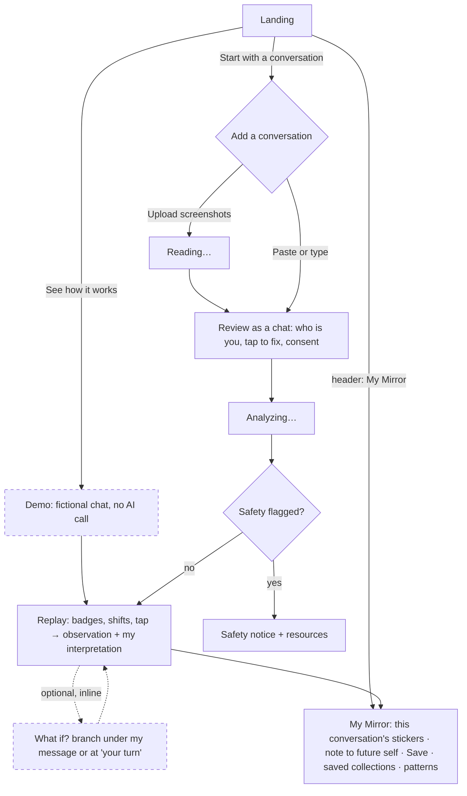

# Prototype v2 — proposal after Founder review

Date: 2026-10-30. Status: **proposal, awaiting Founder approval.** No prototype, product code or asset changes yet.
Input: Founder prototype review (10 items). Prototype v1: `design/prototype/`.

Legend: **[Founder]** = confirmed Founder decision · **[Rec]** = Claude recommendation, needs approval only where listed in §6.

## TL;DR
- Agree with most of the review. It simplifies the flow (2 fewer screens) and makes My Mirror warmer.
- Three pushbacks:
  1. A custom mic would send audio to Google or Apple; the keyboard's own dictation does the job with zero code.
  2. "Linh may feel less defensive" states another person's feelings. What if? should describe the *exchange*, not Linh.
  3. Stickers must not drift into gamification ("collect all five").
- Privacy fix: a saved collection needs **no message text at all**. The current copy "processed once, not stored" is inaccurate, because Meta processes the content and may retain it.
- Scope: everything here is cheap except inline What if? (needs `/api/scenario`) and Patterns (needs a scope change: "long-term profiling" is currently out of scope).

---

## 1. Feedback assessment

| # | Item | Verdict | Rationale and recommendation | Feasibility / impact |
|---|---|---|---|---|
| 1 | Mascot sizing | **Agree** | Measured: in the Founder's sources NP is drawn larger than CP and A (height 0.58 vs 0.50 of the canvas, ~40% more area, heart included). `build_variants.py` keeps one shared scale, so the difference carries into every size. **[Rec] rule:** normalize per form, bottom-aligned on one baseline. Parent and Adult forms (CP, NP, A) get the same visible height H. Child forms (FC, AC) get 0.8 H, which is roughly their current ratio and keeps them "smaller and rounder". Measure on the bounding box including props (NP's heart, A's magnifier). Badges: same idea, the face fills the circle equally. Applied in `build_variants.py` (variants only; sources untouched), so every surface inherits it. | Low. Script change + visual check. Replaces D12. |
| 2 | "See how it works" | **Agree** | Clearer than "Try a sample". One risk: it can read as "watch a video". **[Rec]** add a sub-line under the button: "A short demo with a made-up conversation". Demo mode shows a persistent "Demo · fictional conversation" tag and makes no AI call. | Trivial. |
| 3 | Two input methods | **Agree** | **[Rec]** "Paste or type" opens the chat-style review editor directly (empty), with a composer at the bottom ("Who said it?" + message) and a "Paste many lines at once" option. Typing from memory and pasting then use one component. Typed conversations get an extra uncertainty line in the analysis ("written from memory"). | Medium-low. Merges into item 4's component. |
| 4 | Review as a conversation | **Agree** | **[Rec]** "Which one is you?" sits at the top as two large avatar buttons; after choosing, your bubbles move right. Tapping a bubble opens inline edit: text, "Sent by" avatar toggle, Delete, Done. Possibly cut-off lines get a dashed amber outline and a "may be cut off" tag. Tapping a participant's avatar renames them. Consent + CTA at the bottom. No form fields until you ask for them. | Medium (~3 h). |
| 5 | Initials avatars | **Agree, with two rules** | Best balance: works for all three inputs, no image handling, no third-party faces. **Rule 1:** avatar colors must **never** use the five mascot hues; a colored person would read as "Linh = Critical Parent" and break "labels attach to messages, not people". You = brand lavender; others = neutral tones (slate, sand, stone). **Rule 2:** never use a mascot as a person's avatar. Alternatives considered: real profile photos (privacy, cropping work, no gain); user-picked emoji (one more step, little value). Pseudonym mode shows "A", "B". | Low. |
| 6 | Interpretation quality | **Agree** | See §1.6 below: Phase 0 evaluation without new scope. | Within the $15 budget. |
| 7 | Inline What if? | **Agree with wording change** | Feasible and better than a separate screen. Details in §1.7. **Pushback:** "Linh may feel less defensive" states Linh's feelings, which our AUP framing and product rules forbid. Describe the exchange instead: "A reply from the Adult side might become more likely, and the exchange could move toward the problem itself." | Medium (~4 h incl. API). Removes the Scenario screen. |
| 8A | Sticker collection | **Partially agree** | Warm and on-brand. Risks: gamification (CLAUDE.md: no gamification or dopamine patterns) and "effects" on the artwork (usage rule: no added effects, so no die-cut outlines). **[Rec]** Each sticker = the mascot's `full/` image on a white rounded tile + name + "2 of my messages". Only states the user **chose** for **their own** messages; AI-only suggestions and "not sure" are listed separately in text. No locked or empty slots, no "4/5", no unlock moments; one gentle appear motion (the existing badge settle). | Medium-low. |
| 8B | Patterns over time | **Partially agree** | Valuable, but it is a **scope change**: `MVP_SCOPE.md` lists "long-term profiling" as out of scope. It stays the user's own self-labels, stored locally, so the AUP risk is low. **[Rec] normalization:** per saved conversation, share of the user's own **labeled** messages per state (not-sure shown as a grey segment); across conversations, average the shares so each conversation weighs equally and long chats don't dominate. Show only after **≥ 3** saved collections. Chart: one 100% stacked bar per conversation (last 10, date order), mascot colors **plus** labels, "n conversations · m messages" caption. Weekly/monthly views: post-MVP (hackathon data spans days). Caption: "What you chose for your own messages in saved conversations. Not a measure of personality." | Low–medium (~3 h, no AI). |
| 8C | Note to future self | **Agree on the single field; disagree on a custom mic** | One optional field, "Next time, I want to remember…". A custom mic button would use the Web Speech API, which in Chrome sends audio to Google servers and works unevenly for Vietnamese. That is a new, undisclosed data path in a privacy-first app. **[Rec]** rely on the phone keyboard's built-in dictation (iOS/Android mic key): same result, zero code, no new data path. Revisit after the hackathon. | Saves time. |
| 8D | Merge Mirror + Reflections | **Agree** | Hierarchy in §3.6. Saved-collection detail becomes a sheet, not a screen. | Low. Removes 2 screens. |
| 9 | Privacy and local storage | **Agree: v1 leaked text** | Confirmed: v1 stores `ai.readings`, whose `cues` are verbatim quotes, and the AI rationale and summary paraphrase content. Schema and copy audit in §4. | Low. |
| 10 | Responsive | **Agree** | Table in §3.7. Main change: on mobile, observation/interpretation open as a **bottom sheet** (as `UX_DESIGN.md` says) instead of the v1 panel under the thread; What if? opens inline in the thread. | Included in each item. |

### 1.6 Evaluating interpretation quality in Phase 0 (no new scope)
Reuses the harness, rubric and budget already approved.
1. **Blind expectations first.** Before the run, the Founder reviews and edits the `expected` readings in the 4 fixtures (≈ 15 min), so we judge against the Founder's reading, not ours.
2. **One more Vietnamese fixture** (`05-couple-vi`): indirect, sarcastic, short replies ("ừ", "tuỳ anh"). It tests context and VI nuance, the Founder's main worry.
3. **Stability:** run each fixture twice. ≥ 80% of messages should get the same expression. Users will lose trust if a re-run changes everything.
4. **Two new rubric rows:** *Context* (short replies are read in light of the previous message) and *Stability*.
5. **Founder scores** each conversation 1–3 on: context, plausible TA pattern, evidence, uncertainty, no "facts" about people, VI quality. One page, ≈ 20 min. Claude runs the automatic checks.
6. Optional: 2 What-if calls on one fixture to check the "no feelings of others" boundary, since What if? is now more central.

Cost: 5 fixtures × 2 runs (+ 2 scenario calls) ≈ $0.5–1 worst case, inside the $15 total.

### 1.7 Inline What if? design
- **Entry A (looking back):** a small "What if?" button on each of **my** messages (not only at shifts: answers UX-2).
- **Entry B (next message):** if the last message isn't mine, a ghost bubble at the end of the thread: "Your turn: what if you replied…?"
- **Interaction:** tapping opens a dashed "What if?" branch **inline, right under that message**. Row 1: "Instead of [current state], try…" with the other 4 mascots as large chips (the current state is the user's choice if made, else the AI's, dashed). Row 2, after picking: an illustrative message from that state (dashed bubble). Then "One possible next step": the other person's possible state as mascot + an illustrative reply + one line on the exchange dynamic.
- **Several reactions: sequential.** Show one; "Show another possibility" reveals up to 2 more. That keeps mobile load low and makes "not a prediction" tangible. All are generated in one call and revealed one by one; there are no probabilities.
- **Mobile:** the branch is full-width inside the thread; chips scroll horizontally with ≥ 44 px targets; "Close what if" collapses it. Only one branch open at a time.
- **API:** `/api/scenario` `{ transcript up to turn, turnId | "next", chosenState, lang }` → `{ illustrativeMessage, possibilities[1..3]: { expression, illustrativeReply, dynamic } }`. Cached per (turn, state) in the session. Prompt and checks forbid feelings, motives or traits of others; dynamics describe the exchange. Disabled when safety-flagged. ≈ $0.005 per call, behind the same guard.

---

## 2. Revised user journey


Screens go from 8 to **6**: Landing, Add, Review, Replay, My Mirror, plus Safety. Scenario, My reflections and Saved-detail are removed or merged.

## 3. Prototype v2 change plan

| Screen | Change |
|---|---|
| 3.1 Landing | CTA "See how it works" + sub-line → demo directly. Normalized mascots. "Welcome back" card links to My Mirror. App bar gets a "My Mirror" link. |
| 3.2 Add a conversation | Two cards: Upload screenshots / Paste or type. Sample removed. |
| 3.3 Review | Rebuilt as the chat editor (item 4) + composer for typing. Initials avatars. |
| 3.4 Replay | Initials avatars; inline What if? (A and B); mobile bottom sheet for observation + interpretation; desktop keeps the side panel. Transaction card unchanged. |
| 3.5 Scenario screen | **Removed** (now inline). |
| 3.6 My Mirror (merged) | **Order:** (1) "From this conversation" card: sticker tiles (my confirmed states), a small sequence strip of my messages' states (AI dashed vs mine solid), optional title "What was this about?", note "Next time, I want to remember…", **Save to this device** / "Don't save". (2) Tabs **Collections · Patterns**. Collections = grid of saved cards (stickers, date, title, note excerpt); tapping opens a sheet with details + Delete. Patterns = chart from item 8B, or "Patterns appear after 3 saved conversations". Footer: "Delete everything on this device". From the header (no current conversation), part (1) is hidden. |
| 3.7 Reflections + saved detail | **Removed** (merged into 3.6). |
| Reviewer chrome | Keeps jump/safety/decisions toggles; adds "Seed demo collections" (in-memory, labeled Demo) to preview Patterns. |

**Desktop / mobile (equivalent function, different layout):**
| Area | Desktop | Mobile |
|---|---|---|
| Landing | Hero + 5 mascots in one row | Hero, CTAs full width, mascots 3 + 2 on one baseline |
| Add | Two cards side by side | Stacked cards |
| Review | Screenshot beside the chat | Screenshot collapsed behind "Compare with screenshot" |
| Edit bubble | Inline toolbar | Same, toolbar wraps; Done is ≥ 44 px |
| Observation / interpretation | Sticky side panel | Bottom sheet (thread stays visible behind) |
| What if? | Inline branch in thread | Same, full width, horizontal chips |
| Stickers | 5-column tiles | 3-column tiles |
| Patterns | Bars horizontal, legend right | Bars stacked vertical list, legend above |

## 4. Privacy: what a saved collection keeps

**[Rec] schema (v1 of local storage), no message text, names or AI prose:**
```ts
interface SavedCollection {
  v: 1; id: string; createdAt: string; lang: "en" | "vi";
  origin: "screenshot" | "paste" | "typed";   // demo collections are never written
  title: string | null;                        // user-written, optional
  note: string | null;                         // "Next time, I want to remember…"
  participants: number;                        // count only
  mine: { order: number; ai: Ex | "UNCLEAR"; chosen: Ex | "unsure" | null }[];  // my messages only
  whatIf: { order: number; tried: Ex }[];      // states explored, no generated text
}
```
- **Not kept:** message text, cue quotes, names, AI rationale and summary, generated What-if text, per-message notes (they stay in the session; the UI says "Notes on messages aren't saved. Add anything you want to keep below."). The "keep conversation text" opt-in is **dropped** for MVP; the optional title gives enough context to recognize a collection later.
- **Review and delete:** each card's sheet shows exactly what is stored, with Delete (with undo); "Delete everything on this device" at the bottom of My Mirror.
- **During the session:** transcript and analysis live in memory only (not even sessionStorage); a refresh clears them. The screenshot is dropped when the transcript is confirmed.

**Copy audit (current → proposed):**
| Current | Problem | Proposed |
|---|---|---|
| "Processed once, not stored" | We don't store it, but Meta processes it and may retain it (default retention unspecified; flagged content up to 2 years, `META_API_RESEARCH.md`) | "**We don't keep your conversation.** It's sent to Meta's AI model to be read, and Meta may keep it as described in its terms. Nothing is saved on this device unless you tap Save." |
| "Screenshots are read once and never saved" | Same | "We don't save your screenshots. They're sent to Meta's AI model to read the messages." |
| "Only you can see it" (saved) | Anyone using this browser can | "Saved only in this browser. Anyone who uses this browser could open it." |
| (none) for demo | — | "Demo · fictional conversation, nothing is sent anywhere." |
The privacy page (Q17) must also say: hosting logs request metadata (not content), no accounts, no analytics.

## 5. MVP scope for Nov 4

| Must-have (submission) | Nice-to-have (in this order) | Post-hackathon |
|---|---|---|
| Landing + "See how it works" demo (fictional, no AI) | **Inline What if?** (A + B) | Weekly/monthly pattern views |
| Paste or type → chat review editor | **Patterns** (≥ 3 collections, per-conversation shares) | Custom mic / speech-to-text |
| Screenshot import (conditional P0, §8 gate) | Multi-screenshot (if gate passes single only) | Profile photos, group-chat transaction cards |
| Initials avatars | "Next shift" navigation | Full P/A/C map, game detection |
| Replay: badges, shifts, transaction card, interpretation (bottom sheet on mobile) | | |
| My Mirror: stickers (my confirmed states), note, save, collections grid, delete | | |
| Safety path, privacy page + corrected copy, guards, EN/VI | | |

Cut order unchanged in spirit: multi-screenshot → Patterns → What if? → single screenshot (Paste/type always stays).

## 6. Open decisions (Founder input needed)
| # | Decision | Recommendation |
|---|---|---|
| F1 | Patterns over time in MVP, given "long-term profiling" is out of scope in `MVP_SCOPE.md` | Allow as nice-to-have: own self-labels only, local, ≥ 3 collections, per-conversation shares, no weekly/monthly yet |
| F2 | Stickers and patterns count **only the user's own messages** (never other participants') | Yes (privacy, AUP, and the product is about self-awareness) |
| F3 | Saved data = the schema in §4: no text at all, drop the transcript opt-in, add optional title, don't save per-message notes | Yes |
| F4 | No custom mic in MVP; rely on keyboard dictation | Yes |
| F5 | Inline What if?: must-have or nice-to-have #1? | Nice-to-have #1 (depends on `/api/scenario`; the core loop must ship first) |
| F6 | Approve the proposed privacy copy (§4) as the basis for EN/VI | Yes; VI translation reviewed by Founder |

Handled within the design system without separate approval (visible in prototype v2 for review): Child-to-Parent/Adult height ratio 0.8, avatar neutral tones, bottom sheet on mobile, sequential reveal of possibilities, demo tag wording.
