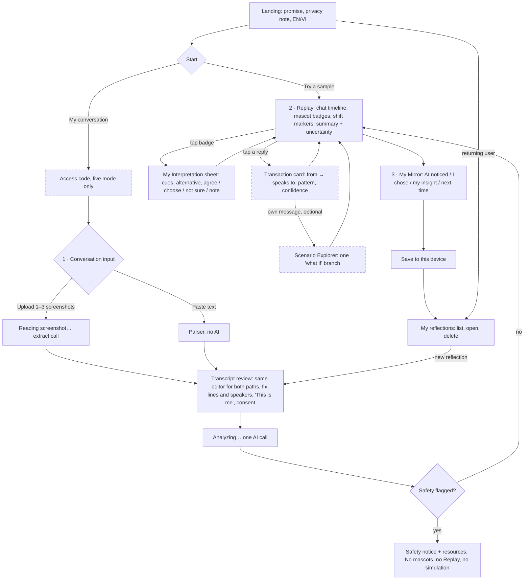
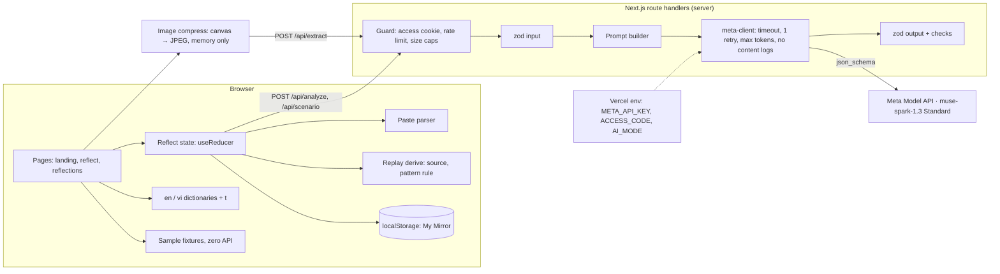

# Architecture Review — whole project

Date: 2026-10-30. Status: **recommendations, awaiting Founder approval.** Approved decisions in other docs still rule; anything here that changes them is listed under §8 and in `OPEN_QUESTIONS.md` Q18–Q25. No application code exists yet (Phase 0 gate still open).

## TL;DR
- The approved concept and stack hold up. No new infrastructure is needed: one Next.js app, one structured AI call per analysis, everything else deterministic code + localStorage.
- Conversation Replay mostly **repackages approved pieces** (Conversation View, turning points, Transaction Map, Scenario Explorer). Recommended: make its simple per-turn transaction card P0 and demote the full SVG map to P2. Net scope goes **down**.
- Main risk: Phase 0 hasn't run. Replay, transactions and the whole demo depend on the model producing reliable **targets** (addressed state). The schedule has no slack if Phase 0 slips past Oct 30.
- Founder action: run Phase 0 (B1), read Official Rules (Q15), decide Q18–Q22 before Phase 1 UI.

---

## 1. Discovery: inconsistencies and gaps

### Conflicts between documents
| # | Where | Conflict | Proposed resolution |
|---|---|---|---|
| C1 | `README.md` | Says the app "reads a screenshot" and uses Muse Image. Phase 1 is paste-first; Muse Image for mascots is out of scope; mascots must never be regenerated. | Update README (Q25) |
| C2 | `TECHNICAL_ARCHITECTURE.md` folder tree | `public/characters/`, "placeholder or Muse Image generated assets", `scripts/generate-characters.ts`, `CharacterBadge`. Approved: `public/mascots/` from Founder assets. | Update (Q25) |
| C3 | `TECHNICAL_ARCHITECTURE.md` types vs `scripts/phase0/schema.mjs` | Doc has model-provided `source`; Phase 0 derives source from expression in code. Doc lacks `addressedTo`, `hiddenMessage`. Mirror stores readings but not transactions. | Schema in code is the newer truth; sync doc after Phase 0 |
| C4 | `META_API_RESEARCH.md` checklist | "(P1) 1 Muse Image call for a character draft" conflicts with mascot rule. | Remove (Q25) |
| C5 | Brief vs docs | "Scenario Simulator" = Scenario Explorer; "Personal Mirror" = My Mirror; "Conversation Shift" = turning point. | Keep doc names; "Conversation shift" only as UI label if Q19 approved |
| C6 | `UX_DESIGN.md` map caption | Crossed = "often where conversations get stuck" leans negative; the new principle says crossed isn't unhealthy. | Neutral copy (Q19) |
| C7 | Product rule vs schema | Product rule: never infer motives of others. `hiddenMessage` on another person's message states a hidden meaning. | Q21 |
| C8 | Design showcase stepper | 4 steps, but Observation and Interpretation happen on the same screen (tap badge → sheet). | Q22 |
| C9 | Judging vs cut order | Third-party summary (unverified): Meta tooling 25%. Cut order drops screenshot import (the only vision use) first. | Q23 after Q15 |
| C10 | `TECHNICAL_ARCHITECTURE.md` testing | "8–10 synthetic screenshots"; Phase 0 uses text conversations. | Screenshots only matter if import is built |

### Missing information (not invented here)
Official Rules (Q15), AUP stance (Q16), VI crisis resources (Q10), theory verification (Q11), VI terminology review (D6), Phase 0 quality and latency (all of §4–§5 of `PHASE0_REPORT.md`), card / auto top-up decision (B2).

## 2. Consolidated product understanding
| | |
|---|---|
| Value proposition | See how *you* shifted in a real conversation, using friendly TA vocabulary, with you as the final authority. |
| Target users | Adults curious about their communication: romance, family, friends, work. Hackathon: adult text chats, 2+ people. |
| Problem | After tense chats people replay what the *other* said, not how they themselves shifted; patterns repeat unseen. |
| Core experience | Conversation → AI Observation → My Interpretation → My Mirror |
| Supporting | Conversation Replay (visual layer of Observation), Scenario Explorer, sample mode, EN/VI, safety path |
| MVP boundaries | No DB, auth, server storage, sharing, analytics, game detection, long-term profiling, branching simulations, native apps |
| Future | Screenshot import if not in MVP, full P/A/C map, patterns across saved reflections (needs a new decision: "long-term profiling" is out of scope), game detection (heavily hedged), voice/other inputs |

**Where Replay fits:** it is how the AI Observation layer is *shown*. It does not add a step or data source; it makes transactions and shifts visible, hands corrections to My Interpretation, and is the doorway to Scenario Explorer.

## 3. End-to-end flow

Core MVP path: Landing → Conversation → Replay (+ Interpretation) → Mirror → Save. Dashed = optional branches (transaction card is P0 but optional to open).

**Navigation (recommended, Q22):** three screens, `/` (landing + "My reflections"), `/reflect` (steps Conversation → Replay → Mirror, client state), `/mirror/[id]` or a panel in `/` for saved items. Stepper shows 3 named steps. Within Replay the three layers stay visually distinct (dashed AI / solid mine), per `DESIGN_SYSTEM.md` §7. Interpretation opens on the user's own first message (D9).

## 4. Application architecture
Unchanged from the approved stack; refined.

| Area | Recommendation |
|---|---|
| Frontend | Next.js App Router, client components for `/reflect`; Tailwind; tokens from `design/showcase/tokens.css`; mascots from `public/mascots/` (copied from `design/brand/mascots/`). One `useReducer` for the flow; no state library. |
| Backend | Route handlers: `/api/analyze` (P0), `/api/scenario` (P1), `/api/access` (sets httpOnly cookie, P0 before deploy), `/api/extract` (P1, Q23). |
| Database / auth | None (approved). Access code only gates live AI calls. |
| AI integration | Plain `fetch` to OpenAI-compatible Chat Completions, `response_format: json_schema`, Standard model only. `AI_MODE=fixtures` returns fixtures for dev, tests and sample mode. |
| Data models | `Transcript`, `Analysis` (Phase 0 schema), derived `ReplayTurn` (client only, `CONVERSATION_REPLAY.md`), `Mirror` with separate `ai` / `user` sections; add `ai.transactions` and optional `user.transactionNotes`. Version field `v: 1` on Mirror for safe future reads. |
| Privacy / security | No server storage or content logging; key server-only; pseudonyms default; consent checkbox; privacy page (ToS §6.2); prompt-injection rule in system prompt; caps 60 messages / 8k chars; `max_completion_tokens` on every call. |
| Localization | Keys from day one; model writes in UI language; codes language-neutral. |
| Hosting | Vercel preview deploy after approval; env vars in dashboard; promotion only if rules require. |

## 5. AI architecture
**One analysis call, everything else deterministic.** No agents, no chains.

| Stage | How | AI? |
|---|---|---|
| Parsing | `Name: message` lines → transcript; user fixes speakers | No |
| Participant identification | User picks "This is me"; names → Person A/B by default | No (AI only in screenshot import) |
| Ego-state reading | `expression`, `target`, `addressedTo`, cues, rationale, confidence, alternative, reflection question (own messages) | **Analyze call** |
| Source state | `SOURCE_OF[expression]` | No |
| Transaction pattern | Complementary/crossed by rule from source/target; model's `ulterior` kept as overlay; disagreement → code wins | Mostly no |
| Shift detection | Model's `turningPoints` (≤ 3), validated to reference real ids | Same call |
| Safety | Model flag + (proposed, Q24) keyword pre-check; either forces safety path | Same call + code |
| User corrections | Stored client-side; pattern recomputed; **never sent back to the model** in MVP | No |
| Reflection storage | localStorage | No |
| Scenario | Separate on-demand call: context up to the chosen own message + chosen expression → alternative message, one possible reply, how the pattern might change | **Scenario call** |

**Validation and normalization after zod:**
- Drop cues that aren't verbatim substrings; if a reading loses all cues, set confidence `low`.
- Missing alternative when confidence ≠ high → show none (normalize, don't retry).
- Hard failures (invalid JSON, missing message ids, forbidden diagnostic/sensitive terms, reflection question on others' messages) → one retry, then a readable error. These checks already exist in `scripts/phase0/checks.mjs`; port them.

**Overinterpretation safeguards:** hedged copy enforced in prompt and templates; confidence in words; "I'm not sure" always; others' messages = observable expression only; second-layer text limited (Q21); no person summaries; no re-analysis loop that could "argue" with the user.

**Cost (estimate, verify in Phase 0):** analysis ≈ 3–6k tokens ≈ $0.01–0.03; scenario ≈ $0.005. Reasoning effort medium, drop to low if latency > 30 s.

## 6. MVP prioritization
| Feature | Value | Complexity | Depends on | AI cost | Demo | Priority |
|---|---|---|---|---|---|---|
| Sample mode (precomputed) | High | Low | Fixtures | 0 | Very high (insurance) | **P0** |
| Paste + parser + speaker fix + "This is me" + consent | High | Low | — | 0 | Medium | **P0** |
| `/api/analyze` + validation | Core | Medium | Phase 0 prompt | 1 call | — | **P0** |
| Conversation View + mascot badges + summary/uncertainty | Core | Medium | Analysis | 0 | Very high | **P0** |
| Shift markers | High | Low | Analysis | 0 | High | **P0** |
| My Interpretation sheet | Core | Medium | View | 0 | High | **P0** |
| Transaction card (Replay) + pattern rule | High (TA differentiator, acceptance #3) | Low–medium | Readings, targets | 0 | High | **P0**, built after the core loop |
| My Mirror save/list/delete | Core | Low | Interpretation | 0 | High | **P0** |
| Safety path + resources | Required | Low | Analysis | 0 | Medium | **P0** |
| Access code, rate limit, caps, privacy page | Required before public | Low | — | 0 | — | **P0** (before deploy) |
| EN/VI (keys + VI copy) | High | Medium (copy) | Q10, D6 | 0 | Medium | **P0** (acceptance #1) |
| Scenario Explorer | Medium–high | Medium | Shifts, safety | +1 call | High | **P1** |
| Screenshot import, single image | High (lowest input friction) | Medium | Feasibility §8 | +1 call | High, Meta tooling | **Conditional P0** (Founder 2026-10-30) |
| Screenshot import, 2–3 images | High | Medium (order, dedupe) | Feasibility §8 | same call | Medium | Conditional P0, else P1 |
| "Next shift" navigation | Medium | Low | Shifts | 0 | Medium | P1 |
| Target / second-layer correction | Medium | Low–medium | Card | 0 | Low | P1 |
| Transcript opt-in in Mirror | Low | Low | Mirror | 0 | Low | P1 |
| Full P/A/C SVG map | Medium | Medium–high | Card | 0 | Medium | **P2** |
| Animated replay playback | Low | Medium | — | 0 | Low | P2 |
| Group-chat transaction cards | Medium | Medium | Pairing quality | 0 | Low | P2 |
| Patterns across reflections, games, accounts, sharing | — | High | New decisions | — | — | P2 / out |

**Challenged:** the full SVG map and animated playback cost a day for little extra understanding over the card. Screenshot import is the riskiest input (VI diacritics, bubbles), hence the conditional P0 gate with Paste Text as fallback.

## 7. Implementation roadmap
Phase gates unchanged. Dates ICT.

| Phase | When | Deliverable (testable) | Depends on |
|---|---|---|---|
| 0 Feasibility | Oct 30 (today) | Live smoke + 4 analyses scored; transaction consistency and target quality known | B1 key |
| 1a Skeleton on fixtures | Oct 31 AM | Scaffold, tokens, mascots, i18n keys, **sample mode end to end**: Replay view → Interpretation → Mirror on fixture data | Phase 0 approval |
| 1b Live core | Oct 31 PM – Nov 1 AM | Paste parser + editor, `/api/analyze` with validation, transaction card + pattern rule, safety path, Mirror list/delete | 1a |
| 1c Screenshot import (if 0.6 passes) | Nov 1 PM | Uploader + compress + `/api/extract` into the same editor | 1b editor, 0.6 |
| 2 Differentiation | Nov 2 | Scenario Explorer (optional); "Next shift"; screenshot import here if it slipped from 1c | 1b loop works |
| 3 Usability | Nov 3 until 18:00 freeze | VI copy, error/loading/empty states, Impeccable polish, access code + rate limit | — |
| 4 Submission | Nov 3 evening – Nov 4 22:00 | Tests, privacy page, preview deploy (approval), demo video, push (approval), submit | Q15, Q12 |

Why fixtures first: the UI and demo stop depending on API latency or Phase 0 tuning, and sample mode (acceptance #7) comes for free. Cut order if late: multi-screenshot → Scenario Explorer → "Next shift" → single-screenshot (Paste Text stays) → VI polish. Never cut safety, privacy, or the core loop.

## 8. Architecture decision review
**Stack:** Next.js (App Router) + TypeScript + Tailwind + zod on Vercel; Meta Model API `muse-spark-1.3` Standard via `fetch`; localStorage. No DB, auth, SDK, state, chart or i18n library.

**Key decisions:** one AI call per analysis; source state and transaction pattern computed in code; user corrections never sent back to AI; Replay is a view, not a new pipeline; fixtures-first build; access code + caps before any public URL.

**Trade-offs:** no DB means no cross-device history (acceptable for privacy and MVP); one big call means one failure point (mitigated by retry + sample mode); code-derived patterns are consistent but only as good as the model's targets; card over SVG map loses some of Berne's diagram fidelity.

**Risks:**
| Risk | Impact | Mitigation |
|---|---|---|
| Phase 0 not run, schedule tight | High | Run today; fixtures-first so UI starts regardless of tuning |
| Unreliable targets | Replay pattern labels wrong | Fallback to badges + shifts only |
| AUP third-party inference | Policy | Observable-only framing; Q16; user-only fallback |
| Card attached, no hard cap | Cost | Access code, rate limit, token caps |
| Overinterpretation reads as diagnosis | Trust, safety | Hedging, confidence, "not sure", Q21 |
| VI quality (copy + model) | Demo for VI users | D6 review, Phase 0 VI fixture |

**Founder decisions:** Q18–Q25 in `OPEN_QUESTIONS.md`, plus existing B1, B2, Q15, Q16, Q10, Q11, D6.

## Addendum — Screenshot Import as conditional P0 (Founder decision 2026-10-30)
Pipeline: **Screenshot(s) → vision extraction → editable transcript → user confirmation ("This is me", consent) → TA analysis.** Feasibility plan and pass bars: `PHASE0_REPORT.md` §8.

Minimal changes, no new infrastructure:
| Change | Detail |
|---|---|
| `POST /api/extract` | Input `{ images: JPEG data URL[1..3], lang }`; output `Extraction` (participants with side + visibleName, messages with legibility, notes). `muse-spark-1.3`, `reasoning_effort` low, strict `json_schema`, zod, one retry. Same guard as other routes. Image only in request memory, never written or logged. |
| Client `image.ts` | Canvas resize (max width ≈ 1080), JPEG q ≈ 0.85, ≤ 3 images, total ≤ ~3.5 MB (Vercel 4.5 MB body limit). Desktop browsers can't decode HEIC: show "use PNG or JPG". |
| One transcript type | Paste and screenshot both produce `Transcript` with `origin: "paste" \| "screenshot"`; per-message `legibility` only for screenshots. Analysis never sees the image. |
| Transcript review | Same editor; low-legibility lines highlighted; image thumbnail beside the editor (browser memory only, dropped on confirm). Self-identification suggested from the right side, always confirmed by the user. |
| Names | Pseudonyms by default, option to use visible names (Q28). |

Trade-offs: an extra call (≈ $0.01–0.02, + latency) and OCR risk in exchange for much lower input friction and real use of Meta vision. Multi-image adds ordering and deduplication risk, so it is gated separately.
